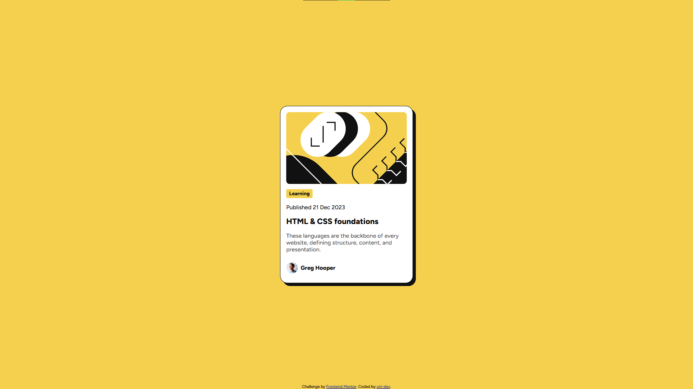

 # Frontend Mentor - Blog preview card solution

This is a solution to the [Blog preview card challenge on Frontend Mentor](https://www.frontendmentor.io/challenges/blog-preview-card-ckPaj01IcS). Frontend Mentor challenges help you improve your coding skills by building realistic projects.

## Table of contents

- [Frontend Mentor - Blog preview card solution](#frontend-mentor---blog-preview-card-solution)
  - [Table of contents](#table-of-contents)
  - [Overview](#overview)
    - [Screenshot](#screenshot)
    - [Links](#links)
  - [My process](#my-process)
    - [Built with](#built-with)
    - [What I learned](#what-i-learned)
    - [Continued development](#continued-development)
  - [Author](#author)

## Overview

### Screenshot



### Links

- Solution URL: [GitHub Repository](https://github.com/ciri-dev/blog-preview-card)
- Live Site URL: [Demo](https://ciri-dev.github.io/blog-preview-card/)

## My process

### Built with

- Semantic HTML5 markup
- CSS custom properties
- Flexbox

### What I learned

Building this blog preview card helped me practice creating a clear, semantic structure for a small article preview with HTML. I used Flexbox to center the card in the viewport and CSS custom properties to keep the color palette and typography consistent.

I also practiced organizing component styles with native CSS nesting, including the card image, category tag, heading hover state, description, and author details. This project reinforced how small details such as spacing, rounded corners, and the offset shadow work together to match a design.

Here are a few snippets of the code I am proud of:

```html
<!-- Keeping the HTML5 structure semantic and straightforward -->
<main>
    <article class="card">
      
      <p class="tag">Learning</p>
      <p>Published 21 Dec 2023</p>
      <h1>HTML & CSS foundations</h1>
      <p class="description">These languages are the backbone of every website, defining structure, content, and presentation.</p>
      <div class="avatar">
        
        <p>Greg Hooper</p>
      </div>
    </article>
  </main>
```

### Continued development

In future projects, I want to continue refining my CSS architecture, especially as I move on to larger layouts and more complex landing pages. I plan to keep utilizing native CSS nesting to write more efficient and readable code.

Additionally, I want to continue streamlining my deployment process for these front-end challenges using GitHub Pages, and I look forward to integrating build tools like Vite or Rollup into my workflow as the scale of the challenges increases.

## Author

- Frontend Mentor - [@ciri-dev](https://www.frontendmentor.io/profile/ciri-dev)
- Twitter - [@ciri_dev](https://www.x.com/ciri_dev)